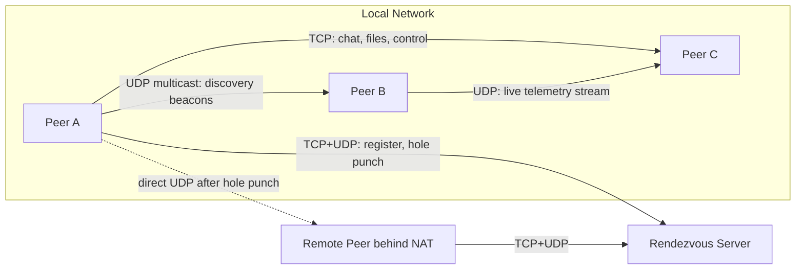

# Socket Programming Mentorship: Building "Tether"

## Ground rules for how we work

- I write the code and the tests. You supervise: you say when to start a step, and you can stop, redirect, or ask for an explanation at any time.
- Atomic steps only. One method, type, or build target at a time. No sprint is implemented in a single pass.
- Before each step I state the path: what I am about to add, which file it goes in, and why it is the next piece. I wait if you have not asked me to continue.
- After each step I build and run the tests that cover that step, then show you the result before moving on.
- You keep reading the sprint concepts (you are on CMake tutorial step 2). I explain the piece I just wrote in terms of those concepts.
- Sprint "done when" checklists are unchanged. A sprint is complete only after its demo and tests pass and you accept it.

## 1. Problem statement

**Tether: a zero-configuration peer-to-peer mesh for real-time collaboration between devices.**

Devices running Tether on the same network find each other automatically, with no server and no IP typing. They can chat, transfer large files reliably, and stream live data (sensor readings, system metrics, cursor positions) at low latency. When peers are on different networks behind NAT, a small rendezvous server helps them connect directly using UDP hole punching, and falls back to relaying traffic only when that fails.

Why this goes beyond a course assignment:

- **Each protocol has a real job.** UDP handles discovery, heartbeats and live streams. TCP handles chat, control messages and file transfer. You'll learn *when* to choose each one, not just how to call them.
- **It needs production-grade techniques:** message framing, partial reads and writes, non-blocking I/O with `epoll`, backpressure, detecting dead peers, building your own reliability layer on top of UDP, NAT traversal, and encryption.
- **It scales in a clear progression:** 2 peers, then a LAN of 50, then a rendezvous server holding 10k+ concurrent connections, then a sharded rendezvous cluster.
- **It's worth showing in a portfolio:** benchmarks, simulated network conditions, fuzz-tested parsers, and a multi-node Docker demo.

## 2. Suggested repository layout

Create this yourself in Sprint 0:

- `CMakeLists.txt` at the root
- `src/net/`: socket wrapper, address helpers, event loop
- `src/protocol/`: message framing, encoding and decoding
- `src/peer/`: the Tether peer application
- `src/rendezvous/`: the rendezvous server
- `tools/`: load generators and a packet-loss test client
- `tests/`: unit tests (GoogleTest)
- `docs/`: your design notes. Write a short one each sprint; it's the habit that makes the project look professional.

## 3. Sprint roadmap

Each sprint has **Concepts**, **Action items** and **Done when**. Plan on roughly 1 to 2 weeks per sprint.

### Phase 0: Foundations

**Sprint 0: C++ and tooling ramp-up**

- Concepts: CMake build basics; compiler warnings (`-Wall -Wextra -Wpedantic`); sanitizers (`-fsanitize=address,undefined`); RAII; move semantics; `std::string`, `std::vector<std::byte>`, `std::string_view`, `std::span`; `std::optional`; exceptions compared with error codes; `errno` and `std::system_error`.
- Action items:
  - Set up a CMake project that builds two executables, `tether_peer` and `tether_rendezvous`, each printing a hello message.
  - Write a small non-network RAII class that wraps a file descriptor from `open()`. It should close the descriptor in its destructor, forbid copying, and allow moving. This is practice for Sprint 1.
  - Add GoogleTest and write one test for it.
- Done when: `cmake --build` compiles cleanly with warnings and sanitizers on, and you can explain why copying a class that owns a file descriptor is dangerous.

### Phase 1: TCP, from basics to scale

**Sprint 1: Blocking TCP echo, the C++ way**

- Concepts: `socket`, `bind`, `listen`, `accept`, `connect`, `send`, `recv`, `close`; `getaddrinfo` instead of hand-filling `sockaddr_in`; IPv4 and IPv6; `SO_REUSEADDR`; the TCP state machine and `TIME_WAIT`.
- Action items:
  - Build a `Socket` RAII class, a `TcpListener`, and a `TcpStream`.
  - Build an echo server and client that work over both IPv4 and IPv6.
  - Turn every failing system call into a clear error that includes the `strerror` text.
- Done when: `nc localhost <port>` can talk to your server; restarting the server immediately doesn't fail with "Address already in use"; you've watched the 3-way handshake in Wireshark or `tcpdump -i lo`.

**Sprint 2: Message framing (the Tether wire protocol, v1)**

- Concepts: TCP is a byte stream with no message boundaries; partial `send` and `recv`; length-prefix framing; network byte order (`htonl`, `ntohl`); version and type fields in a header; checking untrusted input.
- Action items:
  - Design a header on paper first: magic number, version, message type, payload length. Write it up in `docs/protocol.md`.
  - Implement a `sendAll` function and a `recvExact` function, then an encoder and decoder for messages.
  - Define message types `HELLO`, `CHAT`, `PING`, `PONG`, `BYE`.
  - Write unit tests that feed the decoder a message split into 1-byte pieces, and several messages joined in one buffer.
- Done when: the decoder handles any way of splitting the byte stream and rejects oversized or malformed frames without crashing.

**Sprint 3: Multi-client chat (thread-per-client, then `poll`)**

- Concepts: `std::thread`, `std::mutex`, shared state; why thread-per-client doesn't scale; `poll()`-based multiplexing; broadcasting to clients; `SIGPIPE` and `MSG_NOSIGNAL`; graceful shutdown on SIGINT.
- Action items:
  - Version A: a chat room with one thread per client.
  - Version B: rewrite it as a single thread using `poll()`.
  - Handle clients that disconnect halfway through a message.
- Done when: 20 terminal clients can chat, killing any one of them doesn't affect the others, and you can explain the trade-offs between version A and version B.

**Sprint 4: Non-blocking I/O with `epoll`, plus backpressure**

- Concepts: `O_NONBLOCK`, `EAGAIN`/`EWOULDBLOCK`; `epoll_create1`, `epoll_ctl`, `epoll_wait`; level-triggered vs edge-triggered mode; per-connection read and write buffers; `EPOLLOUT` only while data is waiting to be sent; the slow-consumer problem; the C10K problem.
- Action items:
  - Build a reusable `EventLoop` class.
  - Port the chat server onto it.
  - Write a load-generator tool in `tools/` that opens N connections.
  - Cap each connection's write buffer and disconnect clients that fall too far behind.
- Done when: the server holds more than 5,000 concurrent connections on one thread (raise `ulimit -n`), and you've recorded messages per second and memory use in `docs/benchmarks.md`.

### Phase 2: UDP, from datagrams to your own reliability layer

**Sprint 5: Zero-configuration LAN discovery**

- Concepts: `sendto` and `recvfrom`; datagram boundaries; broadcast (`SO_BROADCAST`) vs multicast (`IP_ADD_MEMBERSHIP`, `IP_MULTICAST_TTL`, `IP_MULTICAST_LOOP`); heartbeats; soft state that expires via TTL.
- Action items:
  - Each peer sends a multicast `BEACON` every 2 seconds containing its peer ID, name and TCP port.
  - Maintain a peer table that drops entries after 3 missed beacons.
  - Add the UDP socket to your `EventLoop`, alongside the TCP sockets.
- Done when: starting three peers, on separate machines or in Docker containers, shows each one discovering the others and noticing within about 6 seconds when one is killed.

**Sprint 6: Live telemetry streams, and measuring network imperfection**

- Concepts: packet loss, reordering, duplication, jitter; sequence numbers and timestamps; `SO_RCVBUF`; path MTU and why datagrams should stay under about 1200 bytes; simulating bad networks with `tc netem`.
- Action items:
  - Stream system metrics (CPU and memory from `/proc`) at 50 Hz from one peer to another.
  - Have the receiver report loss %, reorder count and jitter.
  - Run it under `tc qdisc ... netem loss 5% delay 50ms 20ms`.
- Done when: your receiver's statistics match the netem settings within a reasonable margin.

**Sprint 7: A reliable-UDP channel**

- Concepts: ACKs, ACK bitfields (the Gaffer on Games approach), retransmission timers, RTT estimation with the algorithm from RFC 6298, head-of-line blocking, and why QUIC exists.
- Action items:
  - Add an optional reliability layer for selected UDP message types.
  - Benchmark its latency under 5% loss against the same messages sent over TCP.
- Done when: every reliable message arrives exactly once under netem loss, and you've written up the comparison with TCP.

### Phase 3: Peer-to-peer features

**Sprint 8: Reliable file transfer over TCP**

- Concepts: splitting files into chunks, `sendfile()` for zero-copy sending, SHA-256 integrity checks (with OpenSSL), resuming from an offset, progress reporting, handling several transfers at once on the event loop.
- Action items:
  - Implement `OFFER`, `ACCEPT`, `CHUNK`, `DONE` and `RESUME` messages.
  - Transfer a 2 GB file between two discovered peers.
  - Kill the transfer partway through and resume it.
- Done when: the checksums match after an interrupted and resumed transfer.

**Sprint 9: Rendezvous server and NAT hole punching**

- Concepts: NAT types; public vs private endpoints; STUN-like address reflection; simultaneous UDP hole punching; keepalives that hold NAT mappings open; relay fallback.
- Action items:
  - The rendezvous server (built on your `EventLoop`) accepts TCP registrations and reports each peer's observed UDP address.
  - Two peers exchange addresses through the server and hole-punch a direct connection.
  - If punching fails, traffic goes through a relay.
- Done when: two peers on different Docker networks behind simulated NAT (iptables MASQUERADE) connect directly.

### Phase 4: Hardening and scale

**Sprint 10: Security and robustness**

- Concepts: TLS over TCP with OpenSSL (`SSL_read`/`SSL_write` with non-blocking sockets); authenticated encryption for UDP (libsodium); authenticating peers; protecting against oversized frames and slowloris-style attacks; fuzzing.
- Action items:
  - Wrap TCP connections in TLS.
  - Fuzz your frame decoder with libFuzzer for one hour.
  - Add per-IP rate limiting on the rendezvous server.
- Done when: the fuzzer finds no crashes, and Wireshark shows only encrypted payloads.

**Sprint 11: Observability and a scale demo**

- Concepts: structured logging, counters and histograms, a Prometheus-style text endpoint built on your own TCP server, a Docker Compose multi-node setup.
- Action items:
  - Run 20 peers plus 1 rendezvous server in Docker Compose, with a script that injects loss.
  - Load-test the rendezvous server to 10k+ connections.
  - Write the final README, including an architecture diagram and benchmark numbers.

**Stretch goals, if you want to go further**

- Replace `epoll` with `io_uring`.
- Run the event loop on multiple threads with `SO_REUSEPORT`.
- Shard the rendezvous server with consistent hashing.
- Port a module to Boost.Asio and compare it with your raw-POSIX version.
- Make the system work across the internet end-to-end.

## 4. Reading list (roughly in order of use)

Core socket APIs:

- Beej's Guide to Network Programming: [https://beej.us/guide/bgnet/](https://beej.us/guide/bgnet/) (start here; it's the canonical tutorial, written in C, which is exactly what C++ calls underneath)
- Linux man pages at man7.org: `socket(2)`, `bind(2)`, `listen(2)`, `accept(2)`, `connect(2)`, `send(2)`, `recv(2)`, `getaddrinfo(3)`, plus the overview pages `socket(7)`, `ip(7)`, `ipv6(7)`, `tcp(7)`, `udp(7)`, `epoll(7)`: [https://man7.org/linux/man-pages/](https://man7.org/linux/man-pages/)
- W. Richard Stevens, *UNIX Network Programming, Vol. 1* (the definitive book; use it as a reference)
- Michael Kerrisk, *The Linux Programming Interface*, chapters 56 to 61 (sockets) and 63 (I/O multiplexing)

Concurrency and scale:

- Eli Bendersky, "Concurrent Servers" series (parts 1 to 5 map almost exactly onto Sprints 3 and 4): [https://eli.thegreenplace.net/2017/concurrent-servers-part-1-introduction/](https://eli.thegreenplace.net/2017/concurrent-servers-part-1-introduction/)
- Dan Kegel, "The C10K problem": [http://www.kegel.com/c10k.html](http://www.kegel.com/c10k.html)
- "The method to epoll's madness" by Cindy Sridharan: [https://copyconstruct.medium.com/the-method-to-epolls-madness-d9d2d6378642](https://copyconstruct.medium.com/the-method-to-epolls-madness-d9d2d6378642)

UDP, reliability and NAT traversal:

- Glenn Fiedler, "Networking for Game Programmers" (UDP vs TCP, reliability, ACK bitfields): [https://gafferongames.com/categories/game-networking/](https://gafferongames.com/categories/game-networking/)
- Bryan Ford et al., "Peer-to-Peer Communication Across Network Address Translators": [https://bford.info/pub/net/p2pnat/](https://bford.info/pub/net/p2pnat/)
- RFC 6298 (retransmission timeout calculation), RFC 5389 (STUN), RFC 768 (UDP), RFC 9293 (TCP)

C++ refreshers:

- learncpp.com (chapters on classes, move semantics and smart pointers): [https://www.learncpp.com/](https://www.learncpp.com/)
- cppreference.com, for the standard library reference
- CMake official tutorial: [https://cmake.org/cmake/help/latest/guide/tutorial/](https://cmake.org/cmake/help/latest/guide/tutorial/)
- GoogleTest primer: [https://google.github.io/googletest/primer.html](https://google.github.io/googletest/primer.html)

Tools you'll use throughout:

- `nc` (netcat), `ss -tunap`, `tcpdump`, Wireshark, `strace -e trace=network`, `tc netem`, `valgrind`/ASan, Docker Compose

## 5. How each sprint session will go

1. You read the sprint's concepts; I answer questions.
2. I name the next atomic step (one method or one file change) and the file it belongs in.
3. I write that step, build it, and run the relevant test.
4. I show you what changed and what the test did. You accept it or ask for a change.
5. Repeat until the sprint's "done when" checklist passes, then we move on.

